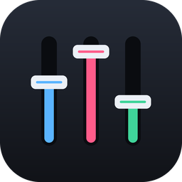

<p align="center"></p>

# BetterVoiceMeeter

A Voicemeeter-style virtual mixer for Focusrite interfaces (Windows), built with C++ and JUCE 9.
It runs directly on the **Focusrite USB ASIO** driver, so a signal going hardware in → processing → hardware out costs only one driver buffer (about 9 ms round trip at 48 kHz / 64 samples).

## Download
Grab the latest `BetterVoiceMeeter-v*-win64.zip` from the [Releases](../../releases) page, extract it, and run `BetterVoiceMeeter.exe`.
Requires a Focusrite interface with the Focusrite USB ASIO driver installed. Optional: [VB-Cable](https://vb-audio.com/Cable/) for the virtual outputs.

## Features
- **Input strips** (one per interface channel, auto-assigned; Focusrite *Loopback 1+2* becomes one stereo strip)
  - Voicemeeter-style XY pad: X = pan, Y = tone (warm ↔ bright tilt EQ)
  - Front-panel Gate and Comp knobs, Reverb/Delay sends, A1–A3 / B1–B2 bus routing, fader + meter, Solo/Mute
  - **FX** button opens the full channel strip: trim, polarity, low-cut, drive/saturation, gate (threshold/range/attack/hold/release),
    3-band parametric EQ with a live curve, compressor (threshold/ratio/attack/release/knee/makeup/auto gain), de-esser,
    plus **presets**: Vocal, Podcast/Stream, Electric Guitar (DI), Acoustic Guitar, Bass (DI), Keys/Synth
- **Noise repair** (channel editor → NOISE REPAIR), for a faulty cable, static, or ground hum:
  - **De-crackle:** detects clicks, crackle, and short dropouts and patches over them (+0.7 ms)
  - **Hum filter:** 50/60 Hz notch plus 4 harmonics (Brazil/US: 60 Hz)
  - **Denoise:** spectral noise reduction that tracks the noise floor automatically, or press
    **LEARN NOISE** for 2–3 s while only the static is audible for a precise profile (+5.3 ms while on).
    Learned profiles are saved.
- **VST3 plugin inserts:** 4 slots per input strip (pre-fader) and per bus (bus **FX** button).
  Scan plugins under **Audio Setup → Scan / Manage VST3 Plugins**. Plugin state is saved with the mix.
- **Sing Studio** (header → SING STUDIO): Moises-style song separation and karaoke inside the mixer
  - Search YouTube, click a song, and it's split into **lead vocal, backing vocals / ad-libs, drums, bass, instruments**
  - Per-stem volume (0–150%), mute, and solo; the song plays through the mixer (route it to A1, plus B1 to stream)
  - Synced karaoke lyrics with word-by-word highlighting. Order: LRCLIB synced lyrics, then LRCLIB text synced to the
    recording with AI (forced alignment), then the engine's own lyrics, then AI transcription (Whisper).
    **FIND LYRICS** re-searches with an edited artist/title.
  - Engines:
    - **Moises (your account)**: about 1 minute per song using your Moises plan. Log in under **ACCOUNT…**
      (email/password, or a session token for Google/Apple sign-in). This uses Moises's web API, not an official one:
      it may break when Moises changes its site, and automated use may go against Moises's terms.
    - **Local GPU** (free, private, offline): BS-RoFormer + MelBand-RoFormer karaoke + HTDemucs, about 5 min per song
      on a GTX 1070. Installed with the in-app button (~3 GB).
    - **Music.AI cloud**: your Music.AI API key + workflow ID (billed per minute by Music.AI)
  - YouTube sometimes requires a login for downloads: log in to YouTube in Firefox, or import a `cookies.txt`
    (exported with "Get cookies.txt LOCALLY") under **ACCOUNT… → Import YouTube cookies.txt…**
  - **Key detection + Auto-Tune**: each song's key is detected from its instrumental stems. With **AUTO-TUNE: MATCH KEY**
    on, the Auto-Tune on your mic strip is set to that key and scale when the song loads, with Auto-Tune Pro's
    low-latency mode (Latency Removal) switched on. **ADD AUTO-TUNE** loads it onto your mic strip. This uses the
    Antares Auto-Tune (Pro, Artist, Access or EFX) installed on your PC; Auto-Tune is licensed Antares software and
    isn't included with BetterVoiceMeeter.
  - Processed songs are kept in a library (`%APPDATA%\BetterVoiceMeeter\Songs`)
  - Downloading from YouTube is against YouTube's terms; use it for personal practice only
- **App Mixer** (header → APP MIXER), three modes:
  - **Volume**: a strip for every app playing audio (Discord, Spotify, games, browsers…) with its icon, device,
    volume, meter and mute. Drives Windows' own per-app volume: no rerouting, no delay.
  - **Groups**: apps play through BetterVoiceMeeter in Game / Chat / Music / Browser groups, each with a **you** (A1)
    and a **stream** (B1) level. Chat and Browser are off the stream by default.
  - **Per-app**: each app gets its own level, mute and A1–B2 routing.
  - Groups and Per-app point each routed app at a silent device you choose (e.g. an unused digital output) and capture
    it from there (~20 ms extra on app audio; your mic stays direct). An app is only mixed once Windows shows it on
    the silent device, so nothing is heard twice; some apps move on their next sound. Switching back to Volume, or
    closing the app, restores every app's own output.
- **2 virtual input strips:** capture any Windows recording device through WASAPI
- **FX returns:** Reverb and stereo ping-pong Delay, each with its own bus routing
- **Master section**
  - A1–A3: Focusrite output pairs
  - B1–B2: any Windows playback device (e.g. VB-Cable "CABLE Input", so Discord/OBS can use "CABLE Output" as a mic)
  - Each bus has a 3-band EQ, limiter, mono, mute, and fader
- Virtual I/O is clock-drift compensated (adaptive resampling FIFO)
- Settings auto-save to `%APPDATA%\BetterVoiceMeeter\settings.xml`; mixes save/load as `.bvm` presets

## Build
Requires CMake ≥ 3.22 and Visual Studio 2019+ (C++ workload).
```
git clone --depth 1 --branch 9.0.3 https://github.com/juce-framework/JUCE.git external/JUCE
cmake -S . -B build -G "Visual Studio 16 2019" -A x64
cmake --build build --config Release
```
Output: `build/BetterVoiceMeeter_artefacts/Release/BetterVoiceMeeter.exe`

## Tests
```
cmake --build build --config Release --target RepairTest PluginSmokeTest
build/RepairTest_artefacts/Release/RepairTest.exe
build/PluginSmokeTest_artefacts/Release/PluginSmokeTest.exe "C:/Program Files/Common Files/VST3/<plugin>.vst3"
```

## Notes
- Preamp gain, 48V phantom power, INST, and AIR are analog settings on the interface. Set them with Focusrite Control 2; this app's **TRIM** is digital.
- Turn off Direct Monitor in Focusrite Control so you don't hear your input twice.
- Device and driver log: `%APPDATA%\BetterVoiceMeeter\BetterVoiceMeeter.log`

## License
AGPL-3.0. Built with [JUCE](https://juce.com) (AGPLv3) and the Steinberg ASIO headers bundled with JUCE.
ASIO is a trademark and software of Steinberg Media Technologies GmbH.
